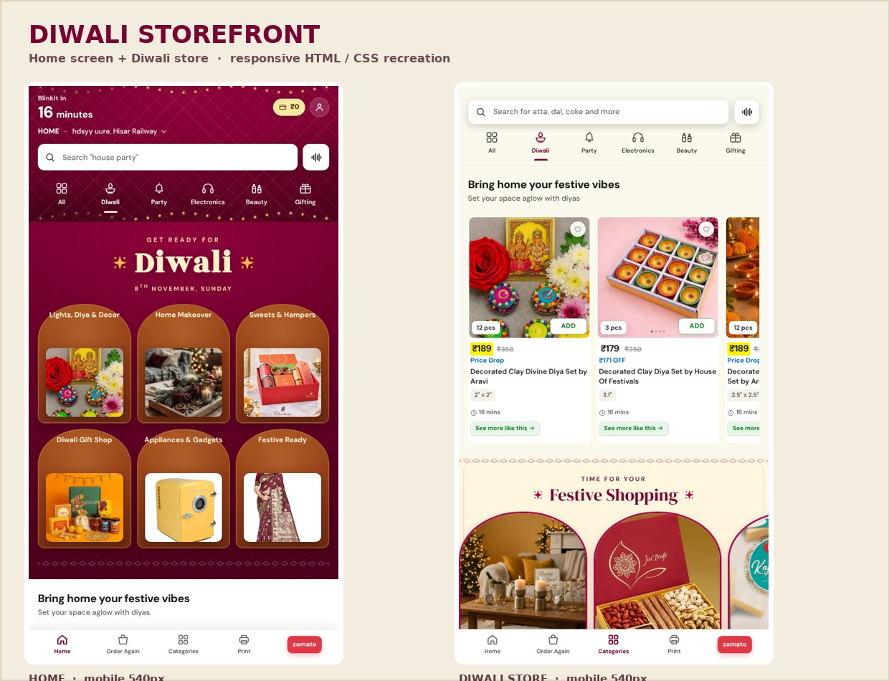

# Diwali Storefront — Home & Diwali screens

> **This folder is the static visual reference, not the app screen.** The
> design that actually runs inside the Flutter app lives in
> [`lib/diwali/`](../lib/diwali/README.md) — it is built from Flutter widgets
> and Dart, reachable from the **Diwali** chip on Home and from `/diwali`.
> This folder is kept as the design source and for the standalone preview.

A pixel-faithful, production-style web recreation of the two attached mobile
screens: the **festive Home screen** (deep-wine delivery header, fairy lights,
"Get ready for Diwali" hero and six arch tiles) and the long **Diwali store
screen** (sticky light header, product carousels, editorial banners, gifting,
decor, lights, calendar, brands, outfit and pooja sections).



## Run it

No build step, no dependencies, no network required — fonts and images are
self-hosted.

```bash
cd festive-ui
python3 -m http.server 3000
# open http://localhost:3000/  (Home)  and  /diwali.html  (Diwali store)
```

Opening `index.html` directly from disk works too.

## Pages

| File | What it is |
| --- | --- |
| `index.html` | Home screen — dark header, search + category tabs, Diwali hero, six arch tiles, festive rails, calendar, brands, promo CTA |
| `diwali.html` | Diwali store — sticky light header and the full 18-section festive storefront |

The two screens are linked through the **Home / Categories** items in the
bottom nav, the **Diwali** category tab, and every tile/banner CTA.

## Structure

```
festive-ui/
├── index.html                 # generated, fully static semantic HTML
├── diwali.html                # generated, fully static semantic HTML
├── preview.jpg                # visual preview
├── assets/
│   ├── css/styles.css         # complete design system + responsive rules
│   ├── js/app.js              # progressive enhancement (no framework)
│   ├── fonts/                 # self-hosted DM Sans, DM Serif Display, Rozha One
│   └── img/                   # 78 optimised local product/lifestyle images
└── tools/build.py             # generator (source of truth for the two pages)
```

`tools/build.py` holds the shared SVG icon sprite, the product catalogue and all
section builders. Re-run it after editing content:

```bash
python3 tools/build.py
```

The generated pages contain all markup, so JavaScript is only used for
behaviour — the content is readable and crawlable without it.

## Design system

- **Palette:** wine `#790131` / `#4B001A`, festive magenta `#A80B4B`,
  cream `#FBF9ED` / `#FFF1CC`, Blinkit green `#0C831F`, offer blue `#0A72C6`,
  price-drop yellow `#FFF200`.
- **Type:** self-hosted **DM Sans** (UI), **DM Serif Display** (editorial
  headings), **Rozha One** (the hero "Diwali"). The rupee glyph ships as tiny
  dedicated `@font-face` micro-subsets because it is absent from the Latin
  subsets — no tofu, no external font requests.
- **Motifs:** generated fairy-light strands, diamond lattice, dotted diamond
  rules, arch-shaped cards, bow and lotus ornaments — all inline SVG/CSS, so
  they stay crisp at any density.
- **Responsive:** mobile-first at 540 px (3-column rails), tablet at ≥600 px
  (4-column rails, rail arrows), desktop at ≥1024 px (5–6 column rails,
  6-across hero tiles, larger editorial type). At ≥1280 px the storefront is
  centred on a soft ambient backdrop.

## Interactions

- ADD buttons turn into − / qty / + steppers and drive a live cart bar with a
  running total.
- Live product search filters all carousels and shows a friendly empty state.
- Wishlist hearts, voice-search state, gift-category chips and tab feedback.
- Draggable / keyboard-scrollable carousels with snap points and arrow controls
  that hide themselves when a rail cannot scroll.
- Sticky header elevation, "Back to top" pill, and IntersectionObserver
  scroll-reveal animations with staggered easing.
- Hover lifts, image zooms, colour inversions on buttons, and twinkling bulbs.
- `prefers-reduced-motion` disables reveal/entrance animation; semantic
  landmarks, `aria-*` labels, alt text, focus rings and a skip link are built in.

## Assets

Product and lifestyle photographs are representative web-sourced images,
resized and re-encoded locally (max 760 px, progressive JPEG) so the pages work
offline. Fonts are sourced from Fontsource packages (DM Sans, DM Serif Display,
Rozha One — SIL Open Font License). No third-party runtime requests.
